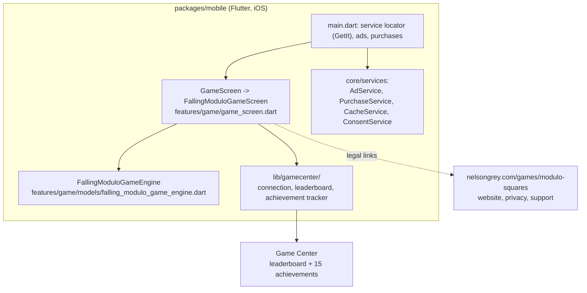

# Modulo Squares

[](https://github.com/NelsonGrey/modulo-squares/actions/workflows/ci-cd.yml) [](https://github.com/NelsonGrey/modulo-squares/blob/develop/LICENSE)

## Contents

- [Demo](#demo)
  - [Architecture](#architecture)
  - [Gameplay walkthrough](#gameplay-walkthrough)
- [Status](#status)
- [Repository Structure](#repository-structure)
- [Product behavior](#product-behavior)
- [Web application](#web-application-legacy)
- [Local setup](#local-setup)
- [Build and validation](#build-and-validation)
- [CI/CD](#cicd)
- [Documentation](#documentation)

Modulo Squares is a falling-number arcade puzzle for iOS built with Flutter, with Game Center for the leaderboard and achievements. Guide each number into one of ten divisor buckets before it lands, build combos, fill the progress grid, and chase a persistent local high score.

The repository contains the mobile app, release automation, and project documentation. It also still holds the legacy Firebase backend and React site from the 1.0.x app; they come out when that version is retired ([docs/GAME_CENTER_MIGRATION.md](docs/GAME_CENTER_MIGRATION.md)). The public website is [https://nelsongrey.com/games/modulo-squares](https://nelsongrey.com/games/modulo-squares).

## Demo

### Architecture



There is no application backend. Identity, the leaderboard and achievements are Game Center; the best score is also stored on the device. See [docs/System_Architecture.md](docs/System_Architecture.md).

### Gameplay walkthrough

The tile-resolution arithmetic below is entirely client-side; this walks through the actual resolution logic in `FallingModuloGameEngine.resolveCurrentTile` (`packages/mobile/lib/features/game/models/falling_modulo_game_engine.dart`). Reporting a new best score is a separate step: the game screen passes it to the Game Center leaderboard when the player is connected.

1. A tile carrying value `F` spawns in the center lane of 10 lanes and begins falling after a 500 ms pause.
2. Ten buckets line the bottom, shuffled at game start: `1`-`9` (scoring) plus one dead bucket `0`.
3. The player taps the Left or Right control to move the tile into a bucket `B` before it lands (180 ms move cooldown, down to 138 ms at combo 8+, from the `1.30x` speed multiplier).
4. On landing, `highestDivisorFor(F)` computes `H`, the largest bucket value 1-9 that divides `F` evenly.
5. Scoring, from `resolveCurrentTile`:
   - `B == H` and `H != 1` → best possible catch: `scoreDelta = 2 * (F * B)`, fill `+2`, combo `+1`, gold "★ BONUS!" burst.
   - `H == 1` (F coprime to every other bucket) and `B == 1` → flat bonus `scoreDelta = F`, fill `+2`, combo `+1`.
   - `F % B == 0`, `B != H`, and `B > 1` → valid but not optimal: `scoreDelta = F * B`, fill `+1`, combo `+1`.
   - `B == 1` and `B != H` (bucket 1 isn't the highest divisor) → valid catch but no reward: `scoreDelta = 0`, fill `+1`, combo `+1`.
   - `B == 0` (dead bucket) → `scoreDelta = -F`, fill `-1`, combo resets to `0`.
   - Otherwise (`F % B != 0`) → `scoreDelta = -(F * B * remainder)`, fill drops by `remainder`, combo resets to `0`.
6. Score is clamped at zero (`max(0, state.score + scoreDelta)`); the 100-cell progress grid fills toward a level-up, and combo streaks raise the horizontal move speed multiplier up to `1.30x` at combo 8+.
7. At level-up the falling number range scales up and the drop interval shrinks toward its floor (`dropIntervalForLevel`, `0.96^(level-1)` decay per `GameDifficulty`), and buckets reshuffle.

Buckets carry no pre-drop hint of which are valid or optimal — the player has to work out the divisibility live. See `docs/Game_Mechanics.md` for the full rule table and `test/models/falling_modulo_game_engine_test.dart` for executable examples of every branch above.

## Status

- Mobile version: `1.1.0+1`
- Platform: iOS only (Android shelved)
- Public website: [https://nelsongrey.com/games/modulo-squares](https://nelsongrey.com/games/modulo-squares)
- Active branch workflow: `.github/workflows/ci-cd.yml`
- Toolchain used by CI: Flutter `3.44.2`, Dart `>=3.7.0`, Node.js `24`
- Current gameplay entry point: `GameScreen` -> `FallingModuloGameScreen`
- App Store: version 1.1.0 has been live since November 6, 2026 (bundle id `com.modulosquares.app.ios`), with Game Center leaderboards and 15 achievements

See [Current State](docs/Current_State.md), [Documentation Index](docs/Documentation_Index.md), and [Go-Live Runbook](docs/GO_LIVE_RUNBOOK.md).

## Repository Structure

```text
.
├── .github/
│   ├── actions/                 # Reusable setup actions
│   └── workflows/               # Active and archived GitHub Actions workflows
├── docs/                        # Product, engineering, operations, and release docs
├── icons/                       # Current icon, proposals, and archived icon assets
├── monitoring/                  # Lightweight runner/deployment status server
├── packages/
│   ├── firebase-utils/          # Shared TypeScript Firebase helpers
│   ├── firestore-rules/         # Firestore security rules
│   ├── mobile/                  # Flutter application and tests
│   ├── shared/                  # Reserved shared package area
│   └── web/                     # React/Vite marketing site and public leaderboard
├── scripts/                     # Environment, signing, deployment, and runner helpers
├── shared-ios-setup/            # Reusable Fastlane/Match reference configuration
├── firebase*.json               # Per-environment Firebase configuration
└── package.json                 # Root orchestration scripts
```

`packages/functions/` is intentionally ignored. For a manual Functions deployment, clone the private `NelsonGrey/modulo-squares-functions` repository into that exact path. CI performs this checkout with `FUNCTIONS_REPO_PAT`.

## Product behavior

The app needs no account. Players can optionally connect to Game Center (prompted on first run, changeable in Settings). The active game includes:

- ten lanes containing shuffled buckets `1` through `9` plus one dead bucket `0`;
- automatic falling with left/right controls and a 500 ms spawn pause;
- a success when `fallingValue % bucketValue == 0`;
- score, combo, high-score, level, and progress-grid feedback;
- optional divisibility cues, persisted locally;
- a Game Center leaderboard and 15 achievements (`docs/GAME_CENTER_SETUP.md`);
- interstitial ads and a non-consumable `remove_ads` purchase with Restore Purchases.

The older board-clearing implementation (`GameBoard`, `GameProvider`, `InstructionsScreen`, grid widgets, and their dedicated tests) was confirmed unreachable from `GameScreen` and removed as dead code (2026-09-11).

## Web application (legacy)

`packages/web` is the retired 1.0.x React site. The public website is [https://nelsongrey.com/games/modulo-squares](https://nelsongrey.com/games/modulo-squares), in the `nelson-grey` repo.

## Local setup

Prerequisites:

- Flutter `3.44.2` recommended; Dart SDK `>=3.7.0 <4.0.0`
- Node.js `24` (`.nvmrc` pins `24`, matching CI)
- Xcode and CocoaPods for iOS work
- Ruby `3.2.2` for the mobile Fastlane setup

```bash
npm install
npm --prefix packages/firebase-utils install

cd packages/mobile
flutter pub get
cd ../..

npm run dev:web
```

The root `install:all` command installs root and Firebase utility dependencies. Flutter dependencies must be fetched separately.

## Build and validation

```bash
# Flutter
cd packages/mobile
flutter analyze
flutter test --coverage
flutter build ios --release --no-codesign

# Web
cd packages/web
npm run lint
npm run build

# Shared Firebase utilities
cd packages/firebase-utils
npm run lint
npm run check
npm run build
```

From the repository root, `npm run lint`, `npm run check`, `npm run build:web`, and `npm run test:app` wrap the corresponding package commands.

## CI/CD

The active pipeline runs for pushes to `develop`, `staging`, and `main`, for pull requests targeting those branches, and by manual dispatch.

- `quality-check`: Flutter analyze and test on Ubuntu
- `build-web`: React production build on Ubuntu
- `build-ios`: TestFlight build/upload on macOS for deployable `staging` and `main` runs
- `submit-app-store`: manual production-only App Store submission gate
- `deploy-web` / `deploy-functions`: legacy Firebase deployments for 1.0.x, removed at decommission
- `deployment-summary`: consolidated result summary

The manual `install-ios-on-hades.yml` workflow is the only intentional self-hosted path.

## Legacy Firebase environments

Dev, staging and prod Firebase projects (`modulo-squares-dev|staging|prod`) still back the 1.0.x app and are decommissioned per [docs/GAME_CENTER_MIGRATION.md](docs/GAME_CENTER_MIGRATION.md).

## Documentation

Start at [docs/Documentation_Index.md](docs/Documentation_Index.md). It labels each document as current, operational reference, planning, or historical so that old implementation proposals are not mistaken for live behavior.
